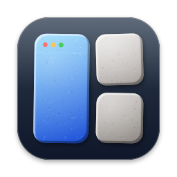
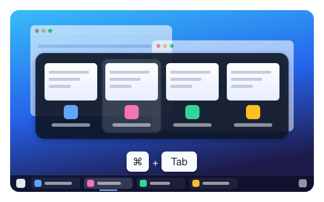
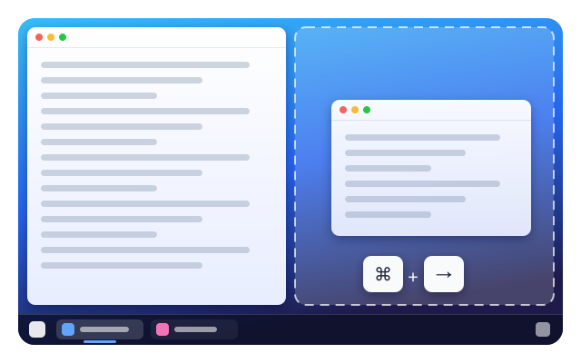
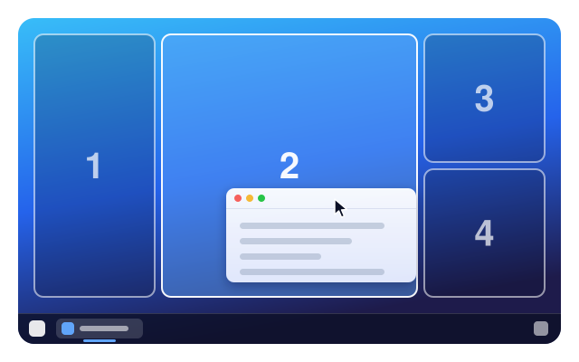
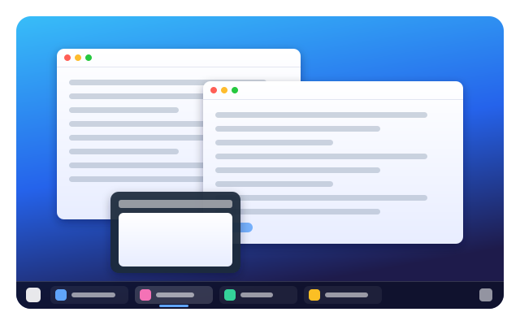
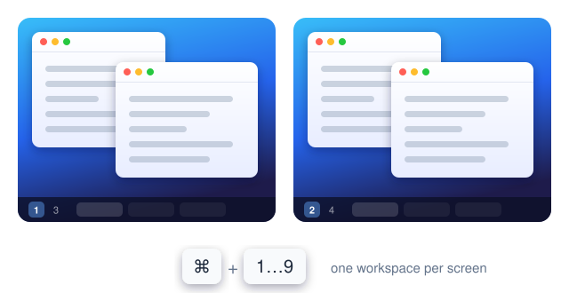
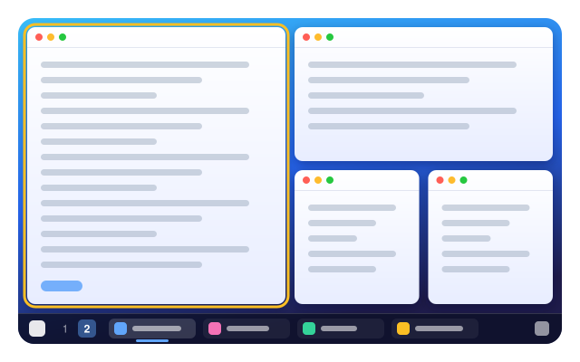
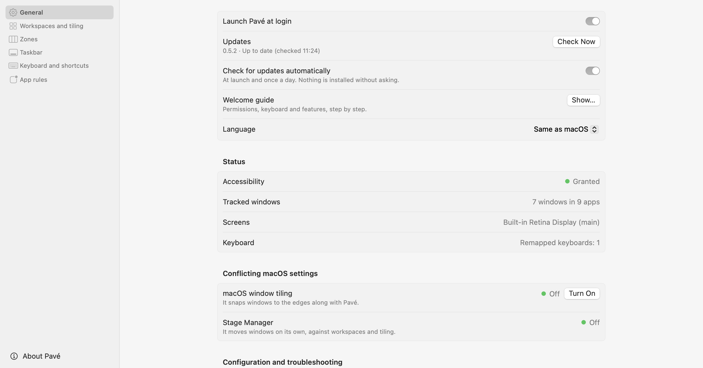
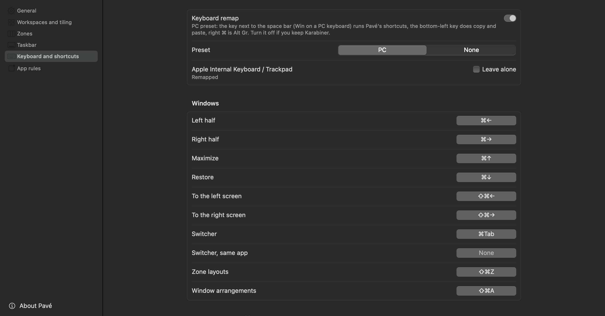
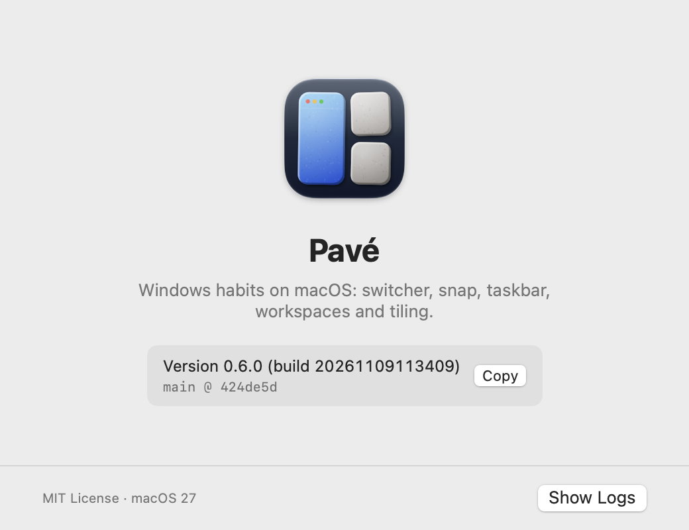

<p align="center">
  
</p>

<h1 align="center">Pavé</h1>

<p align="center">
  <b>Pave the way for your windows.</b><br>
  A window manager for macOS that brings the switcher, snapping, taskbar and workspaces you
  miss, without fighting the Mac you chose.
</p>

<p align="center">
  
  
  
</p>

---

Switching to a Mac after years on Windows or Linux? Your hands still reach for Alt+Tab, still
throw windows against the screen edges, still look for the taskbar at the bottom. Pavé gives
them what they expect: a fast, native agent that lives in your menu bar, stays out of the
way, and makes macOS feel like home.

> Shortcuts are the keys you press with Pavé's PC keyboard preset, on by default: **⌘ is
> the key next to the space bar** on a Mac keyboard, right where a PC has Alt, so ⌘Tab lands
> where your thumb expects Alt+Tab. On a PC keyboard, it is the Win key. Without the preset,
> use ⌃ instead. The Settings window follows the same rule; the config file keeps the
> keys as macOS receives them (`ctrl`).

## What's inside

### Every window, one keystroke away



**⌘Tab** shows every *window*, not every app, in the order you last used them, with live
previews. Hold ⌘ and tap Tab to move along, release to switch. Type to search, **W** closes a
window, **Q** quits its app. A quick ⌘Tab ⌘Tab flips between your last two windows, exactly as
your fingers remember.

### Snap like you mean it



**⌘←** and **⌘→** for halves, **⌘↑** to maximize, quarters from there, **⌘⇧←/→** to send a
window to the next screen. Prefer the mouse? Drag a window to an edge or a corner: a preview
shows where it will land. Hold **⌥** to move it freely.

### Zones for wide screens



Halves are too wide on an ultrawide. Give a screen a **zone layout**, FancyZones style: drag a
window and the zones light up under the pointer, hold **⇧** to span several, **⌥** to move
freely. **⌘←/→** step from zone to zone, then on to the next screen. **⌘⇧Z** picks another
layout, and the windows already in zones follow it. Type two digits there to place the focused
window too: **2** then **4** puts it in zone 4 of the second layout (↩ after the first digit
applies the layout alone).

Outside zones, windows are **magnetic**: dropped near another window or the screen's edge, a
window sticks to it, and against another window it fills the free space beside it. Resize a window by the edge it shares with another, and the other one
follows. Start from Focus (25·50·25), Thirds,
Main and stack, Halves or Grid, or draw your own in the full-screen editor: split, merge,
drag the lines, set the gaps. One layout per screen, another per workspace if you like;
screens without one keep their halves and quarters. An app rule can open an app's windows
straight in a zone, and when a screen is unplugged and plugged back, its windows return to
their zones.

### Arrangements: your desk, in one keystroke

Save the windows as they are ("Code", "Meeting") and put them back later with **⌘⇧A**: each
window returns to its workspace and its place, and apps that are not running are launched and
their windows placed as they open. Pavé recognises windows by app and order only: no title is
ever written to disk.

### A real taskbar



One entry per window, on every screen, with hover previews, pinned apps and drag-and-drop
onto apps; right-click a window to send it to another workspace, or pin its app to one so its
new windows always open there (by window title too). A **Start** button opens a launcher (tap **⌥** alone, like the Windows key), and the
Trash sits where you expect it. Pavé can even hide the Dock while its taskbar is on, and puts
the Dock back exactly as it was when you quit. If the bar ever looks out of place, right-click
Start or an empty part of the bar, then choose **Reset Taskbar** (it is also in the menu bar menu).

### Workspaces that respect your screens



Nine virtual workspaces, no native Spaces animations. **⌘1…9** shows a workspace on its
screen, **⌘⇧1…9** sends the active window there. Each screen shows its own workspace, the
taskbar and the menu bar show their numbers, and you can name them. A Picture in Picture video
stays in sight on every workspace, as do windows you choose (right-click them in the taskbar:
**Show on All Workspaces**).

### Tiling, when you want it



Turn tiling on for the workspaces you choose and keep the others floating. Windows are laid
out in a tree, the way i3 and AeroSpace do it: **⌘⌥ + arrows** moves the focus,
**⌘⌥⇧ + arrows** resizes, **⌘ + arrows** moves the window, **⌘⇧Space** floats it. Windows
that refuse their tile size simply float instead of fighting back.

### Your keyboard, finally

Pavé remaps Mac keyboards to PC habits, per keyboard. The key next to the space bar drives
Pavé's shortcuts; the bottom-left key, where a PC has Ctrl, takes over
copy, paste and the other Mac shortcuts, so **Ctrl+C, Ctrl+V** stay where your fingers expect
them; right ⌘ becomes Alt Gr. Plug in a keyboard, wake
the Mac, change a setting: the mapping is applied and checked again. Prefer
Karabiner-Elements? Pavé steps aside.

### Settings you can see, a file you can trust

<p align="center">
  
  
</p>

A native Settings window, light and dark, in English or French. Behind it, a plain
`config.toml` that stays the single source of truth: edit either one, Pavé reloads on save,
keeps your comments, and refuses a broken file instead of guessing.

## Getting started

You need macOS 15 or later.

### Download the app

Download `Pave_<version>.dmg` from the
[releases](https://github.com/Srynetix/pave/releases), open it and drag Pavé to Applications.
Pavé is not notarized, so macOS refuses to open it the first time (since macOS 15, right-click ›
Open no longer gets around it). Remove the quarantine flag once:

```sh
xattr -dr com.apple.quarantine /Applications/Pave.app
```

(or, after a first refused launch, System Settings › Privacy & Security › **Open Anyway**).
Only the first install needs it: updates are downloaded by Pavé itself.

On first launch, grant **Accessibility** to Pavé in System Settings › Privacy & Security.
Previews need **Screen Recording**, and emptying the Trash asks for **Automation** of the
Finder. A welcome guide walks you through the permissions, your keyboard and what to turn on;
it is in **Settings…** › General if you want it again. Pavé starts conservative, with
workspaces and the taskbar off.

**Updates**: the copy in Applications looks for a newer release at launch and once a day,
and offers it in the menu bar (**Install Pavé x.y…**) and in Settings › General, with what it
brings. Nothing is installed without asking. Releases are read from GitHub's public API, with
no account and no token (for a private fork, through the [GitHub CLI](https://cli.github.com)
and your own access). Before installing, Pavé checks the archive's
[minisign](https://jedisct1.github.io/minisign/) signature against the key it carries, and
that the new app is code-signed like the running one: the Accessibility permission carries
over, and nothing else can be slipped in. Pavé then replaces itself and restarts, with your
parked windows and hidden Dock as they were. A copy you built from source is signed with your
own certificate: it does not look for releases (it could not install them), it updates with
your next `just deploy`.

### Build it

You need Xcode in `/Applications/Xcode.app` and [just](https://just.systems) (`brew install just`).

```sh
git clone https://github.com/Srynetix/pave.git && cd pave
just doctor    # what this machine is missing
just cert      # once: a self-signed "Pave Dev" certificate, so permissions survive rebuilds
just deploy    # builds, installs ~/Applications/Pave.app and launches it
```

`just` lists every other command; `just ci` runs every check.

> Pavé is a personal project, used every day by its author but young. Expect rough edges,
> and please open an issue when something feels wrong.

How the code is built, the development loop, localization and releases are in
[`docs/dev/`](docs/dev/README.md).

<details>
<summary><b>Configuration</b></summary>

`~/.config/pave/config.toml` (or `$PAVE_CONFIG`), created on first launch with every default
commented. Most settings are also in the Settings window.

- **Hot reload**: saved, applied. An invalid file is rejected and the previous configuration
  stays active; the error and its line show in the menu, in Settings and in `pave config`.
- `[workspaces]`: `enabled`, `names`, `icons`, `tiling` (e.g. `[2, 3]`), `gaps`. `icons` are
  drawn in the taskbar instead of the numbers, one per workspace from 1: an emoji, up to
  2 letters, or `"sf:<name>"` for an SF Symbol (it follows the bar's colours), `""` to keep the
  number. E.g. `icons = ["🌐", "sf:chevron.left.forwardslash.chevron.right", "✉️"]`. An unknown
  symbol keeps the number. Like names, icons never reach the logs.
- `[switcher]`: `scope`, `"workspace"`, `"screen"` (the screen in use) or `"all"`.
- `[keyboard]`: `remap`, `preset` (`"pc"` or `"none"`), `skip` (keyboards left alone, by the
  `vendor:product` ID from `pave keyboards`, or `"built-in"`).
- `[taskbar]`: `enabled`, `hide-dock`, `start-key`, `grouping` (`"never"`, `"always"`,
  `"when_full"`), `pinned` (bundle IDs).
- `[zones]`: `enabled`, `gaps`, `show` (`"always"`, or `"ctrl"`: only while ctrl is held),
  `keyboard` (arrows move between zones). `[zones.screens]` gives each screen a layout (key:
  its UUID, `builtin`, or part of its name; value: a layout or `"none"`), `[zones.workspaces]`
  one per workspace number, on screens that have one. `[layouts."<name>"]` defines a layout:
  `zones = [[x, y, width, height], …]` in percent of the usable area (the editor writes it).
- `[apps."<bundle id>"]`: `ignore`, `drag-snap`, `taskbar-overlap = "allow"`,
  `workspace = N`, `tile = false`, `zone = N` (new windows open in that zone). `pave apps` lists the bundle IDs of running apps.
- `[apps."<bundle id>".profiles]`: for browsers with profiles (Brave, Chrome, Edge all run
  one app for every profile, and end each window title with ` - <profile>`), the workspace of
  each profile's new windows:

  ```toml
  [apps."com.brave.Browser".profiles]
  Work = 3
  Perso = 1
  ```

  A profile not listed gets the app's `workspace`, if any. When the browser names its window a
  moment after opening it, Pavé looks at the title for 2 s: the window then goes to its
  profile's workspace, which is shown if the window is in front. Titles are only compared,
  never logged. Windows already open stay where they are.
- `[apps."<bundle id>".titles]`: the same, by pattern on the whole window title, for apps
  without ` - <profile>`: `*` is any text, `?` one character, case ignored.

  ```toml
  [apps."com.example.prism".titles]
  "*Work" = 3       # titles ending with "Work"
  "*poc-mac-wm*" = 2  # titles containing "poc-mac-wm"
  "Picture*" = "all"  # on every workspace
  ```

  The pattern with the most characters other than `*` wins. Profiles come first, then titles,
  then the app's `workspace`. The taskbar's right-click menu has **Pin to Workspace**: all the
  app's windows (its `workspace`), **This Window** (a title rule from the window's title, then
  Settings to shorten it to what stays the same, `*Work`; or **All Workspaces**), and **Pin by
  Window Title…**, which opens the app's rule in Settings. A window its app keeps above the
  others (Picture in Picture) is shown on every workspace without a rule; **Show on All
  Workspaces** in a window's menu does the same for that window until it closes.
- `[windows]`: `magnet` (points, default `12`, `0` off): a window dropped this close to
  another window's edge or the screen's sticks to it (against it, or lined up), with a preview
  while dragging; `magnet-fill` (default `true`): stuck against another window, it also fills
  the free space there (next to a window on the right 2/3, it takes the first third; dragged
  away, it gets its size back); `resize-neighbours` (default `true`): resizing a window by an edge another
  window touches (even across a zone gap) moves that window's edge along, live. ⌥ while
  dragging turns both off.
- `[updates]`: `check` (look for a newer Pavé at launch and once a day, default `true`),
  `source` (the GitHub repository, `"Srynetix/pave"`).
- `[bindings]`: e.g. `snap-left = "ctrl+left"`, or `"none"`. Letters follow the keyboard
  layout (`z` is the key that types z, on AZERTY too). Shortcuts are written as macOS receives them, after the remap: with the
  "pc" preset, `ctrl` is the ⌘ key you press (next to the space bar), and `cmd` the
  bottom-left key. The Settings window shows the keys you press.

The "pc" keyboard preset:

| Keyboard | Mapping |
|---|---|
| Every keyboard | left ⌘ → ⌃ (the key next to the space bar; Win on a PC keyboard), right ⌘ → right ⌥ (Alt Gr) |
| Built-in | fn → ⌘, left ⌃ → fn: the bottom row `fn ⌃ ⌥ ⌘` becomes `⌘ fn ⌥ ⌃` |
| External (Mac layout) | left ⌃ → ⌘: `⌃ ⌥ ⌘` becomes `⌘ ⌥ ⌃` |

With `hide-dock`, the Dock is also shrunk to its smallest icons and moved to the left (Mission
Control always shows it, as a thin strip away from the taskbar). Its settings are saved in `~/.local/state/pave/dock.json` and restored
when the setting goes off or Pavé quits; after a crash, `pave restore-dock` works even
without Pavé. While hidden, the Dock is never shown again: if a management tool rewrites its
settings, Pavé hides it again, and the space macOS sometimes keeps reserved for it is used anyway
(the taskbar stays at the bottom).

</details>

<details>
<summary><b>Command line</b></summary>

```sh
pave --help
pave dump                 # what Pavé knows, as JSON (titles hidden unless --titles)
pave snap left            # also: snap right, maximize, restore, screen left|right
pave workspace 3 --screen builtin
pave move-to 2
pave tiling toggle
pave zones                # each screen's zone layout; also: zones set LG thirds, zones edit, zones on|off
pave arrangement save Code    # also: arrangement restore Code, arrangement delete Code, arrangement
pave update               # look for a newer Pavé and show what it brings; update install: install it
pave keyboards
pave restore-all          # bring every parked window back on screen
```

The CLI is built as `build/pave`. It talks to Pavé over `~/.local/state/pave/pave.sock`
(mode `0600`; `PAVE_SOCKET` changes it). Logs are in `~/Library/Logs/Pave/pave.log`.

</details>

## Privacy

**Private by design.** Window titles, workspace names and icons never reach the logs. Previews stay in memory. The control
socket only answers your own user, and the app runs with the hardened runtime: no other code
can be injected into it to borrow its permissions. Pavé needs Accessibility to move windows,
and nothing leaves your Mac.

<p align="center">
  
</p>

## Documentation

- [Developing Pavé](docs/dev/README.md) — how the code is built: architecture, patterns, the
  development loop, releases
- [Decisions](docs/adrs/README.md) — every technical choice, and what it was chosen against

## How it was made

Pavé was designed, tested and used by its author, with the help of an AI coding
agent ([Claude Code](https://claude.com/claude-code)). The agent wrote most of the code and the
tests under the author's direction; the design decisions, the testing on real machines and the
choice of what ships remain the author's. It is part of the
[P suite](https://github.com/Srynetix/p-suite), apps made this way.

## Contributing

Bug reports, ideas and pull requests are welcome: [CONTRIBUTING.md](CONTRIBUTING.md) says how,
and [SECURITY.md](SECURITY.md) how to report a security problem privately.

## License

Dual-licensed under either of [MIT](LICENSE-MIT) or [Apache 2.0](LICENSE-APACHE), at your
option. Unless you state otherwise, any contribution you submit for inclusion is dual-licensed
the same way, with no additional terms.
