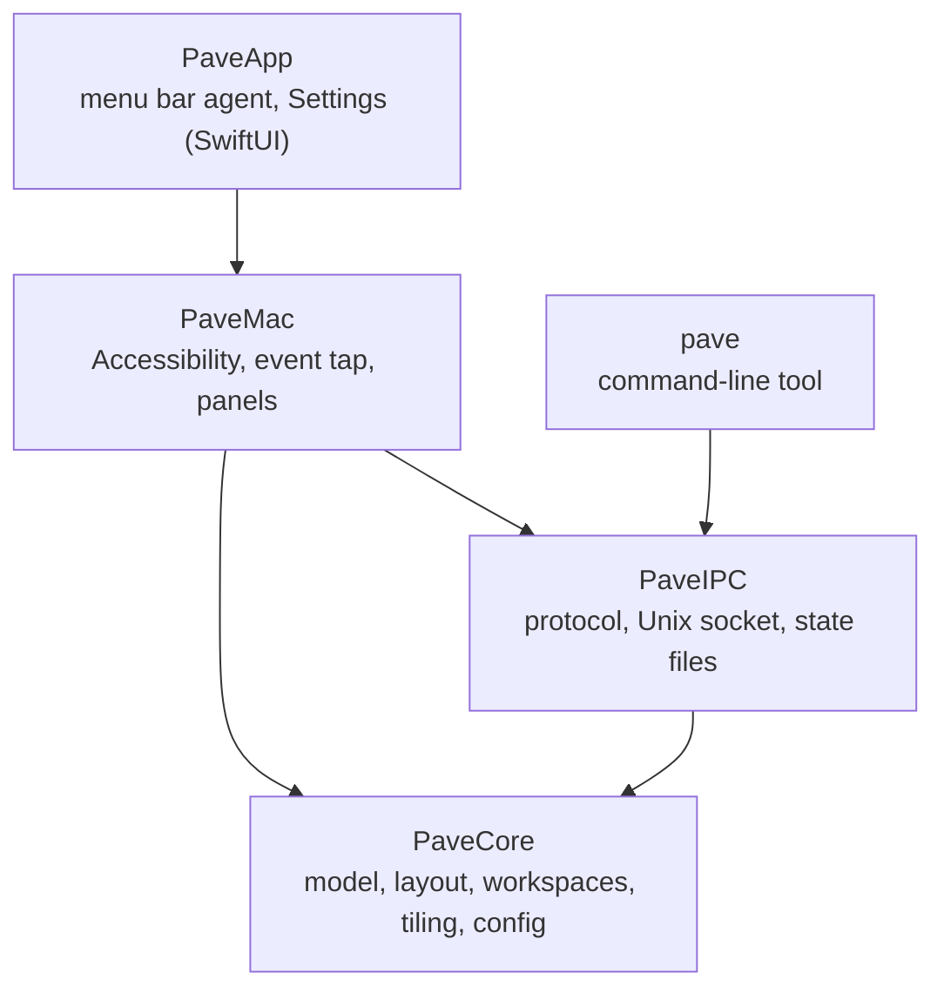
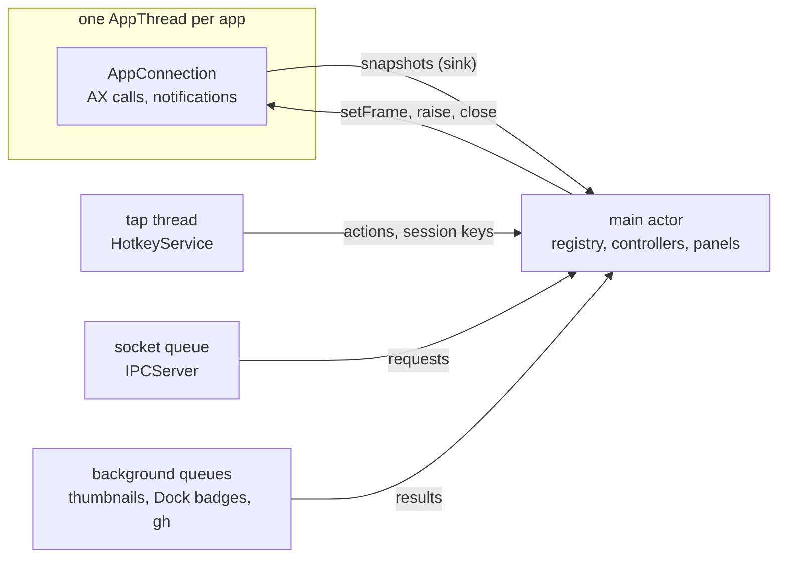
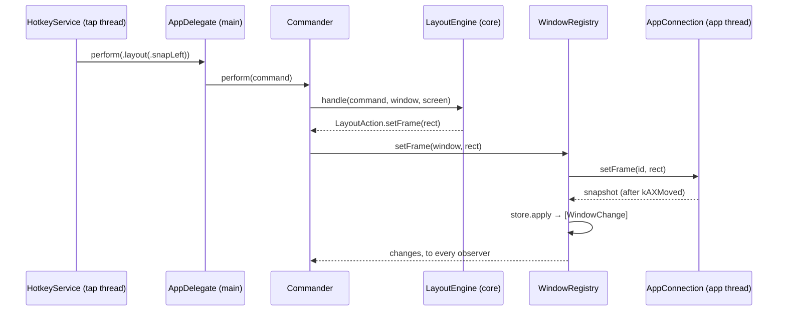

# Architecture

Pavé follows the suite's architecture rules ([SUITE.md § 12](https://github.com/Srynetix/p-suite/blob/main/SUITE.md#12-code)):
the rules of window management live in a core that knows nothing of macOS, and every
dependency points toward it.

## Layers

| Target | Holds | Depends on | Enforced by |
|---|---|---|---|
| **PaveCore** — [`Sources/PaveCore`](../../Sources/PaveCore) | The model (windows, screens, rectangles), every decision: placement, zones, workspaces, tiling, the switcher, the taskbar's content, the config and its parser, update checks | Foundation and CryptoKit only | Its own target in [`Package.swift`](../../Package.swift): it cannot import PaveMac, and does not import AppKit |
| **PaveIPC** — [`Sources/PaveIPC`](../../Sources/PaveIPC) | The CLI's JSON protocol, the Unix socket, the sub-command parser, the state directory | PaveCore, Foundation | Its own target |
| **PaveMac** — [`Sources/PaveMac`](../../Sources/PaveMac) | Everything that talks to macOS: Accessibility, the event tap, `hidutil`, the Dock, ScreenCaptureKit, `gh`, and the AppKit panels (taskbar, switcher, pickers, zone editor) | PaveCore, PaveIPC, AppKit | Its own target |
| **PaveApp** — [`Sources/PaveApp`](../../Sources/PaveApp) | The composition root (`AppDelegate`), the menu bar item, the Settings, About and welcome windows | PaveMac, PaveCore, PaveIPC, SwiftUI | An executable target nothing depends on |
| **pave** — [`Sources/pave`](../../Sources/pave) | The CLI: parses, sends one request, prints the answer | PaveCore, PaveIPC | An executable target; it cannot reach PaveMac |

PaveCore and PaveIPC are tested by [`Tests/`](../../Tests) without a window, a permission or a
running app. PaveMac and PaveApp are tested by hand, on a real Mac (see
[Departures](#departures-from--12)).

## Modules

### PaveCore

| Module | Responsible for |
|---|---|
| [`Model`](../../Sources/PaveCore/Model.swift), [`Rect`](../../Sources/PaveCore/Rect.swift) | Window and app snapshots, window changes, rectangles in Accessibility coordinates |
| [`WindowStore`](../../Sources/PaveCore/WindowStore.swift) | Every known window and the MRU order; turns a new snapshot into changes |
| [`Layout`](../../Sources/PaveCore/Layout.swift) | `LayoutEngine`: what a snap command, a drop or a zone move does to a window, Windows 11 style |
| [`SnapZones`](../../Sources/PaveCore/SnapZones.swift), [`Magnet`](../../Sources/PaveCore/Magnet.swift) | Where a dragged window would snap; magnetism and shared edges |
| [`ZoneLayout`](../../Sources/PaveCore/ZoneLayout.swift), [`ZoneEditing`](../../Sources/PaveCore/ZoneEditing.swift) | Zone layouts, and the editor's operations with undo |
| [`Workspaces`](../../Sources/PaveCore/Workspaces.swift), [`ParkingSpot`](../../Sources/PaveCore/ParkingSpot.swift) | Which workspace each window and screen has; where to park a hidden window |
| [`TilingTree`](../../Sources/PaveCore/TilingTree.swift) | The tiling tree of one workspace and the frames it gives |
| [`Switcher`](../../Sources/PaveCore/Switcher.swift) | The window switcher as a state machine |
| [`Taskbar`](../../Sources/PaveCore/Taskbar.swift), [`TaskbarOverlap`](../../Sources/PaveCore/TaskbarOverlap.swift), [`WorkspaceIndicator`](../../Sources/PaveCore/WorkspaceIndicator.swift) | What each taskbar shows; which windows slide under it |
| [`Launcher`](../../Sources/PaveCore/Launcher.swift) | Which apps match what was typed in the Start launcher |
| [`Arrangement`](../../Sources/PaveCore/Arrangement.swift) | Saved arrangements and how windows are matched to them |
| [`Config`](../../Sources/PaveCore/Config.swift), [`ConfigField`](../../Sources/PaveCore/ConfigField.swift), [`TOML`](../../Sources/PaveCore/TOML.swift), [`ConfigEdit`](../../Sources/PaveCore/ConfigEdit.swift), [`TitlePattern`](../../Sources/PaveCore/TitlePattern.swift) | The configuration: a TOML subset reader, the parser and its defaults, edits as text, title patterns |
| [`Hotkey`](../../Sources/PaveCore/Hotkey.swift), [`KeyRemap`](../../Sources/PaveCore/KeyRemap.swift) | Shortcuts and the actions they trigger; which keyboard gets which remapping |
| [`Updates`](../../Sources/PaveCore/Updates.swift), [`Minisign`](../../Sources/PaveCore/Minisign.swift), [`Blake2b`](../../Sources/PaveCore/Blake2b.swift) | Which release is newer and which file installs; checking its minisign signature |
| [`Samples`](../../Sources/PaveCore/Samples.swift) | Timing samples for the log's p50 / p95 |

### PaveMac

| Module | Responsible for |
|---|---|
| [`AppThread`](../../Sources/PaveMac/AppThread.swift), [`AppConnection`](../../Sources/PaveMac/AppConnection.swift), [`AXElement`](../../Sources/PaveMac/AXElement.swift) | One thread and one Accessibility connection per app: snapshots, notifications, moves |
| [`WindowRegistry`](../../Sources/PaveMac/WindowRegistry.swift), [`SpaceTracker`](../../Sources/PaveMac/SpaceTracker.swift) | Owns the `WindowStore`, merges the apps' snapshots, publishes changes |
| [`Commander`](../../Sources/PaveMac/Commander.swift) | Runs layout commands: asks `LayoutEngine`, applies the result |
| [`DragSnapController`](../../Sources/PaveMac/DragSnapController.swift), [`SnapPreview`](../../Sources/PaveMac/SnapPreview.swift), [`ZonesOverlay`](../../Sources/PaveMac/ZonesOverlay.swift) | Snapping, zones and magnetism while dragging with the mouse |
| [`WorkspaceController`](../../Sources/PaveMac/WorkspaceController.swift), [`StateStore`](../../Sources/PaveMac/StateStore.swift) | Applies `Workspaces` (parks and restores windows), persists it, recovers after a crash |
| [`TilingController`](../../Sources/PaveMac/TilingController.swift) | Applies a `TilingTree` per tiled workspace |
| [`SwitcherController`](../../Sources/PaveMac/SwitcherController.swift), [`SwitcherPanel`](../../Sources/PaveMac/SwitcherPanel.swift), [`ThumbnailService`](../../Sources/PaveMac/ThumbnailService.swift), [`FocusService`](../../Sources/PaveMac/FocusService.swift) | The switcher: session, panel, previews, bringing one window to the front |
| [`TaskbarController`](../../Sources/PaveMac/TaskbarController.swift) and its extensions, [`TaskbarPanel`](../../Sources/PaveMac/TaskbarPanel.swift), [`TaskbarPreview`](../../Sources/PaveMac/TaskbarPreview.swift), [`LauncherPanel`](../../Sources/PaveMac/LauncherPanel.swift), [`DockBadges`](../../Sources/PaveMac/DockBadges.swift), [`Trash`](../../Sources/PaveMac/Trash.swift) | One taskbar per screen, its previews, menus, launcher, badges and Trash |
| [`DockController`](../../Sources/PaveMac/DockController.swift) | Hides and restores the Dock |
| [`ZonePicker`](../../Sources/PaveMac/ZonePicker.swift), [`ZoneEditor`](../../Sources/PaveMac/ZoneEditor.swift), [`ArrangementPicker`](../../Sources/PaveMac/ArrangementPicker.swift), [`ArrangementController`](../../Sources/PaveMac/ArrangementController.swift) | The pickers, the zone editor, saving and restoring arrangements |
| [`HotkeyService`](../../Sources/PaveMac/HotkeyService.swift), [`KeyboardLayout`](../../Sources/PaveMac/KeyboardLayout.swift), [`KeyboardRemapService`](../../Sources/PaveMac/KeyboardRemapService.swift) | The event tap and its sessions; the keyboard layout's characters; `hidutil` remapping |
| [`ConfigStore`](../../Sources/PaveMac/ConfigStore.swift) | Reads, watches and reloads the config file |
| [`IPCServer`](../../Sources/PaveMac/IPCServer.swift) | Serves the CLI on the Unix socket |
| [`UpdateService`](../../Sources/PaveMac/UpdateService.swift) | Fetches releases, checks and installs an update |
| [`Screens`](../../Sources/PaveMac/Screens.swift), [`Permissions`](../../Sources/PaveMac/Permissions.swift), [`NativeTiling`](../../Sources/PaveMac/NativeTiling.swift), [`Restart`](../../Sources/PaveMac/Restart.swift), [`Shell`](../../Sources/PaveMac/Shell.swift), [`Log`](../../Sources/PaveMac/Log.swift) | Screens in AX coordinates, permissions, macOS settings that fight Pavé, restarts, running programs, the log |
| [`Private`](../../Sources/PaveMac/Private.swift) | Every private macOS API, and nothing else |

### PaveApp

[`main.swift`](../../Sources/PaveApp/main.swift) holds `AppDelegate`, which builds every
controller, wires their callbacks and routes shortcuts. One extension per feature keeps it
readable: [`+Menu`](../../Sources/PaveApp/AppDelegate+Menu.swift),
[`+Settings`](../../Sources/PaveApp/AppDelegate+Settings.swift),
[`+Zones`](../../Sources/PaveApp/AppDelegate+Zones.swift),
[`+Arrangements`](../../Sources/PaveApp/AppDelegate+Arrangements.swift),
[`+IPC`](../../Sources/PaveApp/AppDelegate+IPC.swift),
[`+Updates`](../../Sources/PaveApp/AppDelegate+Updates.swift). The Settings window is SwiftUI,
driven by [`SettingsModel`](../../Sources/PaveApp/SettingsModel.swift).

## Threads

Every Accessibility call is a blocking IPC to another app, and an app can hang. So no AX call
runs on the main thread.

- **The main actor** owns all state: the registry and its store, the controllers, the panels.
- **One [`AppThread`](../../Sources/PaveMac/AppThread.swift) per app**, with its own run loop,
  runs that app's AX calls and receives its notifications. A hung app blocks only its thread;
  the registry marks it unresponsive.
- **The tap thread** runs the `CGEventTap`, so a shortcut is never delayed by the rest of Pavé.
  When macOS disables the tap anyway (a timeout, secure input), it is re-enabled at once.
- **The socket queue** reads and writes CLI requests; requests are handled on the main actor.

## Main flows

### A shortcut moves a window

`AppDelegate.perform` sends a command to the [`TilingController`](../../Sources/PaveMac/TilingController.swift)
instead when the window's workspace is tiled.

### A window appears

1. The app's `AppConnection` receives `kAXWindowCreated`, takes a snapshot of the app's
   windows, and sends it to the registry on the main actor.
2. `WindowStore.apply` compares it with what it knew and returns `.created`.
3. The registry hands the changes to every observer: the `WorkspaceController` gives the
   window its workspace (from its app rule or its title), the `Commander` places it in its
   zone if a rule says so, the `TilingController` inserts it in the tree, the taskbar adds
   its button.

### The config file changes

1. [`ConfigStore`](../../Sources/PaveMac/ConfigStore.swift) sees the write (it watches the
   file and its directory), and parses the text with `PaveConfig.parse`.
2. An invalid file is rejected: the previous config stays, and the error, with its line,
   shows in the menu, Settings and `pave config`.
3. A valid one goes to `AppDelegate.apply`, which hands each part to its controller.

Menu toggles and the Settings window do not set state directly: they edit the file
([`ConfigEdit`](../../Sources/PaveCore/ConfigEdit.swift)) and this flow does the rest.

### The CLI asks something

`pave` parses its arguments (shared parser in [`Subcommands`](../../Sources/PaveIPC/Subcommands.swift)),
sends one JSON line on `~/.local/state/pave/pave.sock`, and prints the one JSON answer.
`IPCServer` reads it on its queue and calls `AppDelegate.handle` on the main actor
([`+IPC`](../../Sources/PaveApp/AppDelegate+IPC.swift)), which runs the same code as the
shortcut or menu item.

## Platform code

- **Private macOS APIs** (`_AXUIElementGetWindow`, a few CGS functions): only in
  [`Private.swift`](../../Sources/PaveMac/Private.swift), behind `PrivateAPI`. The raw symbols
  are `fileprivate`.
- **Accessibility** calls: only through [`AppConnection`](../../Sources/PaveMac/AppConnection.swift)
  on its app's thread, with the typed accessors of [`AXElement`](../../Sources/PaveMac/AXElement.swift).
- **External programs** (`hidutil`, `ps`, `killall`, `osascript`, `gh`): only through
  [`Shell`](../../Sources/PaveMac/Shell.swift), never through a shell.
- **Coordinates**: AppKit's bottom-left origin is converted once, in
  [`Screens`](../../Sources/PaveMac/Screens.swift); everything else uses Accessibility's
  top-left origin.

## Departures from § 12

| Where | What departs | Why | ADR |
|---|---|---|---|
| PaveCore | The core defines no ports: it never calls out. The shell calls it with plain values and applies the actions it returns ([pattern](patterns.md#a-pure-core-decides-the-shell-applies)) | Same dependency rule, fewer types: every decision is a pure function, tested as such | — |
| PaveMac controllers | Sequencing (timers, retries, waiting for a window to settle) lives in the controllers, outside the core, and is tested only by hand | It depends on how macOS and the apps answer in time; the decisions inside it are in the core | — |
| PaveMac | Adapters (Accessibility, tap, `hidutil`) and AppKit UI (panels, pickers, editor) share one target | They share the main actor and the registry; splitting them is possible when the target gets in the way | — |
| PaveApp | `AppDelegate` is the composition root and also routes actions between controllers, over about 1,500 lines in seven files | One place where everything is wired; the extensions keep each feature apart | — |
| PaveCore | `Minisign` uses CryptoKit, an Apple framework | It is pure computation, available wherever Swift runs on Apple platforms | — |
